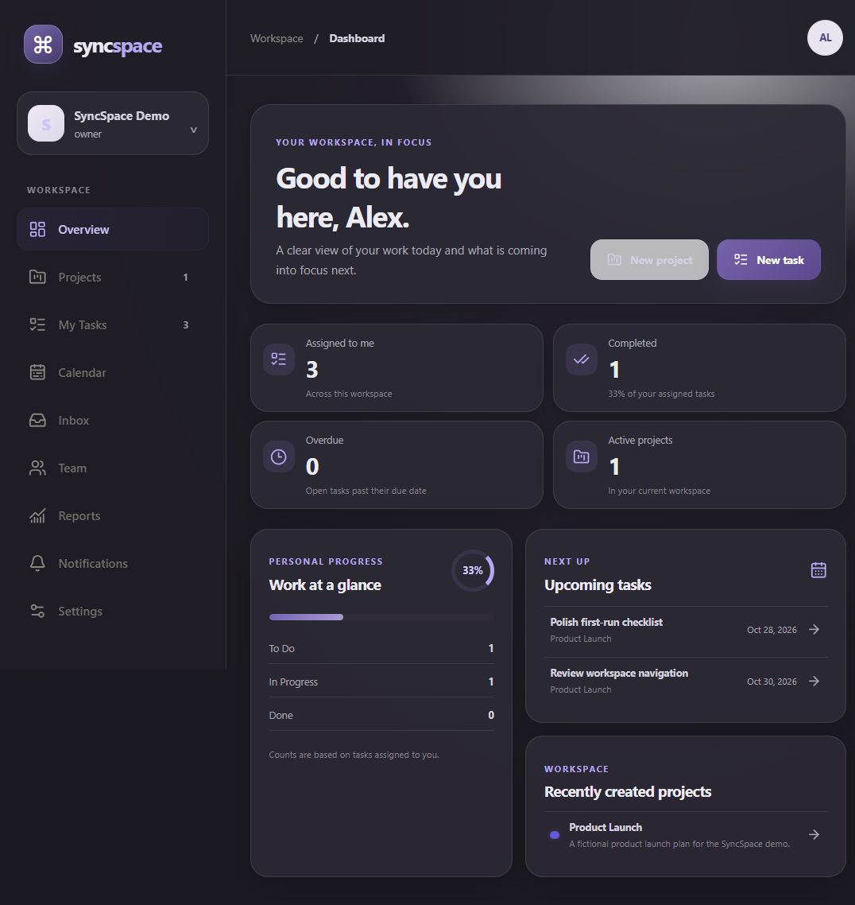
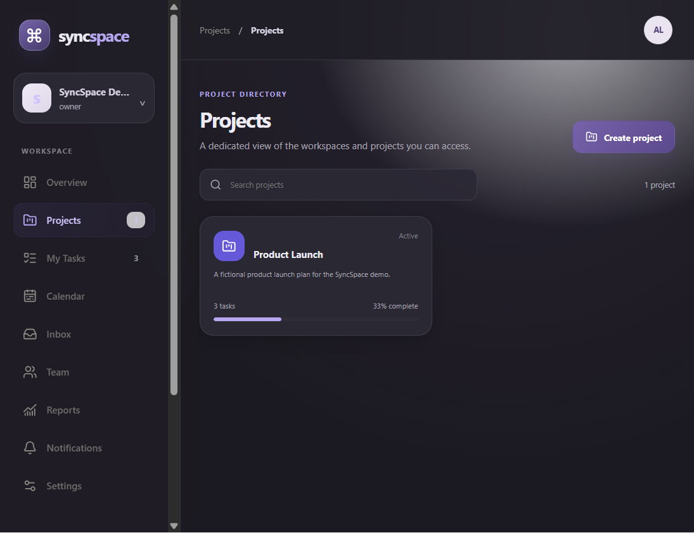

# SyncSpace

SyncSpace is a full-stack workspace and task-planning app for organizing project work without scattering tasks across disconnected boards. It combines a React interface with an authenticated FastAPI API and a SQLite database.

> **Status:** In development. There is no public hosted demo or project screenshot in this repository yet.

## Features

- Email/password registration and login with password hashing and opaque, expiring server-side sessions.
- Workspace-scoped projects, memberships, and task data.
- Project directory and individual project task boards, plus a personal assigned-tasks view.
- Task creation, editing, deletion, status/priority filtering, sorting, due dates, and tags.
- Dashboard summaries, a due-date calendar, workspace member/task summaries, and project reports.
- Persistent task-assignment notifications with read/unread controls.
- Profile and appearance preferences, including light, dark, and system themes; password changes revoke other active sessions.
- Additive SQLite startup migration that preserves existing task records.
- Responsive layout and browser back/forward navigation across URL-backed pages.

## Screenshots and demo

The screenshots below show the app running locally with a synthetic demo account, workspace, project, and tasks. They are not a hosted deployment; no public demo is currently available.

### Dashboard



### Project directory



## Technology

- **Frontend:** React 19, TypeScript, Vite, and lucide-react.
- **Backend:** Python, FastAPI, SQLModel/SQLAlchemy, and Uvicorn.
- **Database:** SQLite by default; `DATABASE_URL` accepts other SQLAlchemy-supported database URLs.
- **Tests and quality:** Python `unittest`, TypeScript compilation, ESLint, and Vite production build.

## Requirements

- Python 3.11 or later.
- Node.js 22.12 or later (npm is included with Node.js).

## Run locally on Windows

Open two PowerShell terminals from the repository root.

### 1. Configure the backend

Create the local environment file if it does not already exist:

```powershell
if (!(Test-Path .env)) { Copy-Item .env.example .env }
```

The checked-in `.env.example` contains local development defaults only. Keep real credentials and production configuration outside Git.

```powershell
Set-Location backend
python -m venv .venv
.\.venv\Scripts\python.exe -m pip install -r requirements.txt
.\.venv\Scripts\python.exe -m uvicorn main:app --reload
```

The API will be available at `http://127.0.0.1:8000`.

### 2. Configure and run the frontend

In the second terminal, from the repository root:

```powershell
if (!(Test-Path frontend\.env)) { Copy-Item frontend\.env.example frontend\.env }
Set-Location frontend
npm ci
npm run dev
```

Vite prints the local URL (normally `http://localhost:5173`). The development API URL is configured by `VITE_API_BASE_URL` in `frontend/.env`; its example value is `http://localhost:8000`.

## Environment variables

| Variable | Location | Purpose |
| --- | --- | --- |
| `DATABASE_URL` | root `.env` | SQLAlchemy database URL. The default is a local SQLite file in the backend working directory. |
| `CORS_ORIGINS` | root `.env` | Comma-separated, exact frontend origins permitted by the API. |
| `COOKIE_SECURE` | root `.env` | Set to `true` when HTTPS is used; local development defaults to `false`. |
| `VITE_API_BASE_URL` | `frontend/.env` | API origin used by the browser app. |

Restart the backend after changing its environment. Configure exact trusted origins and secure cookies for deployment; do not copy development values into a production environment without review.

## Tests and production build

Run backend tests from the repository root:

```powershell
Set-Location backend
.\.venv\Scripts\python.exe -m unittest discover -s tests -v
```

Run frontend checks:

```powershell
Set-Location frontend
npm ci
npm run lint
npm run build
```

The production frontend bundle is generated in `frontend/dist/`. It is a build artifact and should not be committed.

For contribution scope and pull request checks, see [CONTRIBUTING.md](./CONTRIBUTING.md). GitHub Actions runs the backend test suite and frontend lint/build for pushes to `main` and pull requests.

## Architecture

```text
Browser
  React app (frontend/src/App.tsx, frontend/src/pages/WorkspacePages.tsx)
    ├── URL-backed navigation (History API)
    └── Typed API client (frontend/src/services/api.ts)
          └── JSON requests with session cookies and the selected workspace ID
                ↓
FastAPI (backend/main.py)
  ├── Validates origins for state-changing requests
  ├── Resolves the user from the session cookie
  ├── Verifies membership in the selected workspace
  └── Reads and writes workspace-scoped records
        ↓
SQLModel sessions → SQLAlchemy engine (backend/database.py)
        ↓
Database configured by DATABASE_URL
  └── SQLite by default: backend/syncspace.db
```

The API client sends requests with browser credentials and includes `X-Workspace-ID` when a workspace is selected. The backend validates the session cookie against a stored token digest and expiry, then checks that the user belongs to the requested workspace before serving protected workspace routes. Project and task reads and writes are scoped to that workspace; notification access is also scoped to its recipient. The database engine uses `DATABASE_URL`, with SQLite as the local default. The frontend uses the History API for page navigation.

## API documentation

Start the backend and open:

- Interactive Swagger UI: `http://127.0.0.1:8000/docs`
- OpenAPI schema: `http://127.0.0.1:8000/openapi.json`

Important page routes include `/dashboard`, `/projects`, `/projects/{project_id}`, `/my-tasks`, `/calendar`, `/team`, `/reports`, `/inbox`, `/notifications`, and `/settings`. Dashboard and reports use `/dashboard/summary` and `/reports/summary`; account preferences and password changes use `/settings/preferences` and `PATCH /auth/password`.

## Database and migration safety

The default database is `backend/syncspace.db`. Back it up before upgrading an existing installation. Startup uses additive table/column creation and does not intentionally delete task records. Existing legacy tasks without a verified workspace remain inaccessible through authenticated routes until deliberately associated with one.

Never commit local database files, backups, or database exports. The repository `.gitignore` excludes common SQLite database and backup extensions.

## Security notes

Passwords are hashed with PBKDF2-HMAC-SHA256 and unique salts. Browser sessions use random tokens in `HttpOnly`, `SameSite=Strict` cookies; the server stores token digests and supports logout/session revocation. State-changing browser requests are origin-checked. Authentication rate limits are process-local and are not sufficient abuse protection for a production deployment.

This project is not yet a production-ready multi-user service. It does not currently include email delivery, password reset, email verification, invitation workflows, advanced role management, comments, activity feeds, file uploads, or a distributed session/rate-limit store. Email notification preferences are persisted, but email is not sent. Completion-over-time reporting is unavailable because task completion timestamps are not stored.

## Current pages

- **Dashboard:** current-user assignment/deadline summary, upcoming tasks, and active projects.
- **Projects:** searchable directory and per-project task boards.
- **My Tasks:** tasks assigned to the signed-in user.
- **Calendar:** monthly view based on saved task due dates.
- **Team:** existing workspace members and task counts; no invite or role-management controls.
- **Reports:** workspace totals and task/project distributions.
- **Inbox and Notifications:** assignment notices and read state.
- **Settings:** account profile, persisted preferences, and password change.

## Potential follow-up work

The following are not implemented or committed release promises; they are candidate improvements for future development:

1. Invitation and role-management workflows with authorization tests.
2. Email verification, password reset, and optional email delivery through a configured provider.
3. Task comments/activity history and completion timestamps for historical reporting.
4. Production deployment hardening, including shared rate limiting/session storage, operational monitoring, and a reviewed CSRF strategy.

## License

No license has been selected or included. Until one is chosen, do not assume that the source is licensed for reuse.
